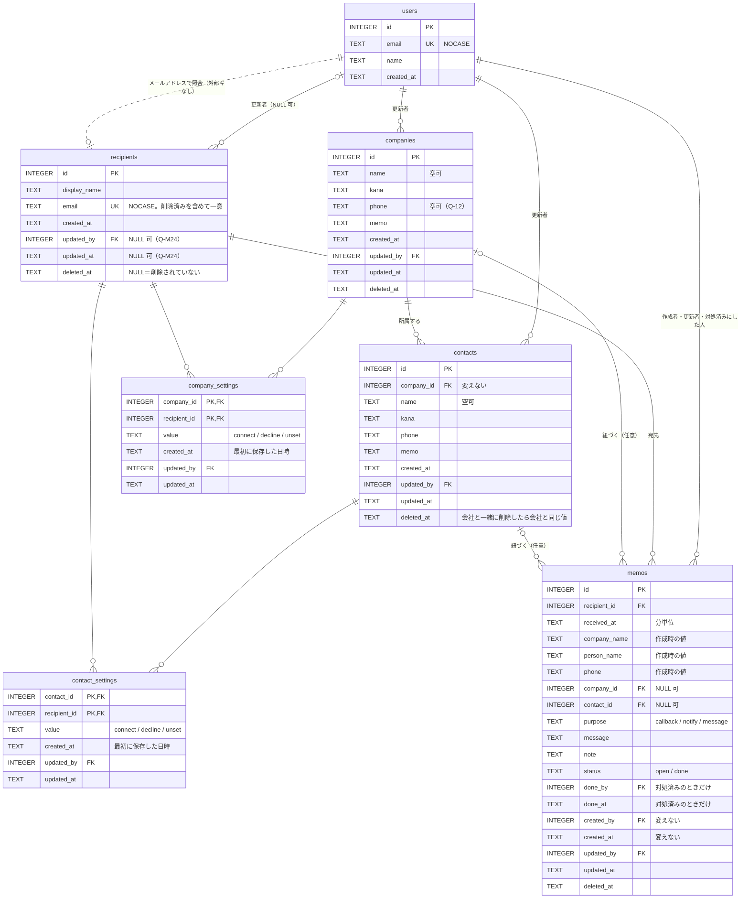

# DB 設計（STEP1）

STEP1 仕様書（`docs/spec.md` v0.4）にもとづく、Cloudflare D1（SQLite）の設計。

| ファイル | 中身 |
|---|---|
| `docs/db/README.md` | 方針、ER 図、テーブルの一覧、未決・確認したいこと（このファイル） |
| `docs/db/tables.md` | テーブルごとの列・制約・インデックス |
| `docs/db/queries.md` | 画面ごとの取り方・更新のしかた（SQL）、エンジニアが DB で行う操作 |
| `migrations/0002_create_step1_tables.sql` | テーブルを作るマイグレーション |

- 仕様の正は `docs/spec.md`。この設計と食い違ったら仕様書を正とし、設計を直す
- 設計のもとにしたもの：仕様書 3章・6章・8章・11章、`docs/questions.md`、STEP1 モック（`mock/step1` の `src/repo/`・`src/domain/`）

## 1. 方針

### 1.1 表記
- テーブル名・列名は英語の snake_case にする（仕様書 Q-06：DB 上の表記は DB 設計で決める）。仕様書の用語と DB の表記の対応は、このフォルダ（`docs/db/`）を正とする。仕様書 3章には DB の表記を載せない
- 区分の値は英語のコード値を TEXT で持ち、CHECK で値を絞る。コード値はモックと同じ

| 区分 | 画面の表記 → DB の値 |
|---|---|
| 取次可否 | つなぐ → `connect`、つながない → `decline`、未設定 → `unset` |
| 取次メモの用件 | 折り返し希望 → `callback`、連絡があったことをお伝え希望 → `notify`、伝言希望 → `message` |
| 取次メモの状態 | 未対処 → `open`、対処済み → `done` |

### 1.2 日時
- UTC で持つ。表示・入力・期間の絞り込みのときに、アプリで日本時間（Asia/Tokyo）に変換する
- 型は TEXT にし、JS の `Date#toISOString()` と同じ `YYYY-MM-DDTHH:MM:SS.sssZ`（例：`2026-11-05T05:30:00.000Z`）の形で持つ
- この形でない値は CHECK で弾く：`x IS strftime('%Y-%m-%dT%H:%M:%fZ', x, '+0 seconds')`
  - 日時として計算し直した値と一致するかを見る。実在しない日付（`2026-02-30`）、形の違う値（`2026-11-05 14:30`、`+09:00` 付き、ミリ秒なし）、`24:00` を弾く
  - `=` ではなく `IS` で比べる。日時として読めない値（`'abc'`、空文字、数値）は `strftime` が NULL を返すので、`=` だと結果が NULL になり、CHECK を通ってしまう。`IS` なら読めない値は偽になり、列が NULL のとき（削除されていない `deleted_at` など）は真になる
  - `'+0 seconds'` は日時を計算し直させるため。付けないと `24:00` がそのままの文字列で返り、通ってしまう
- 受電日時は分単位なので、秒以下を `00.000` に固定する（CHECK）

#### なぜ TEXT か
SQLite（D1）には日時の型がない。値を持つ型は NULL・INTEGER・REAL・TEXT・BLOB の5つだけで、日時の関数（`strftime`・`datetime` など）は、次のどれかで持った値を日時として読む。

| 持ち方 | 例 |
|---|---|
| TEXT（ISO 8601） | `2026-11-05T05:30:00.000Z` |
| INTEGER（UNIX 時刻。秒またはミリ秒） | `1793856600` |
| REAL（ユリウス日） | `2461349.729…` |

- 列の型を `DATETIME` と書くこともできるが、SQLite は NUMERIC の扱い（型アフィニティ）にするだけで、日時の型にはならない。日時の型があるように見えて紛らわしいので使わない
- 3つのうち TEXT（ISO 8601）を選んだ理由
  1. **DB を直接見て読める**：削除したデータの復旧はエンジニアが DB を操作して行う（仕様書 2.2）。`deleted_at = '2026-11-07T02:00:00.000Z'` のように、`SELECT` の結果をそのまま条件に書ける。数値だと、毎回変換しないと「いつか」が分からない
  2. **形をそろえれば、文字列のまま並べ替え・比較できる**：桁数が固定の UTC の形なら、文字列の順番と時刻の順番が一致する。受電日時の新しい順の並べ替え、期間の絞り込み（`>=`・`<`）がそのまま正しく動き、インデックスも効く
  3. **アプリとの受け渡しに変換が要らない**：保存は `toISOString()`、読み出しは `new Date(値)` で済む。STEP1 モックも同じ形で持っていた
  4. **実在しない日時を弾ける**：`strftime` で計算し直した値と一致するかを CHECK で確かめるので、`2026-02-30` のような値は入らない
- INTEGER（エポックミリ秒）にしなかった理由：容量が少し小さく、比較が少し速く、形の CHECK も要らないという利点はある。ただ、この規模（社内の電話の記録。仕様書 Q-07 は未定）では速さ・容量の差は問題にならないので、DB を直接見たときの読みやすさを優先した

#### 気をつけること
- 形が崩れると並び順が狂う（例：`2026-11-05 14:30`、`+09:00` 付きの日本時間）。CHECK で弾くので DB には入らないが、アプリでも、保存するときは必ず UTC の `toISOString()` を使う
- 日本時間の日付で絞り込むときは、アプリで日本時間の 0:00 を UTC に変換してから比べる（例：2026/11/02 の始まりは `2026-11-01T15:00:00.000Z`）

### 1.3 論理削除
- 削除日時 `deleted_at` で持つ（仕様書 8.1。v0.4 で削除フラグから変更）。NULL なら削除されていない
- 削除するときは、`deleted_at` と同じ日時で `updated_by`・`updated_at` も記録する（削除も「更新」として更新者を残す。仕様書 F-06・F-07・F-09）
  - 削除済みの行は画面から編集できないので、削除後の `updated_by` は「削除した人」になる
- **会社を削除したら、所属する担当者にも会社と同じ `deleted_at` を入れる**（仕様書 8.1）。それより前に個別に削除されていた担当者は、`deleted_at` が会社と違うので見分けられる。復旧するときは、会社と同じ `deleted_at` の担当者だけを戻す（`docs/db/queries.md` 5章）
  - 個別の削除と会社の削除がミリ秒まで同じ時刻になると見分けられなくなるので、同じ会社に同じ時刻で削除された担当者がいるときは会社を削除せず、時刻を1ミリ秒進めてやり直す（`docs/db/queries.md` 3.3）
- エンジニアが DB で復旧するときは、`deleted_at` を NULL に戻すだけにする。`updated_by`・`updated_at` は変えない（削除した人・日時が残る。2026-11-17 決定）
  - そのため復旧したあとは、S-06・S-08・S-10 の更新者・更新日時に、削除した人・削除した日時が出る（次に画面から編集するまで）
- 削除されていない行だけを返すことは、アプリの repo の既定にする（一覧・検索・プルダウン・取次可否の表示に出さない）
- 一覧・検索で使うインデックスは、削除されていない行だけの部分インデックス（`WHERE deleted_at IS NULL`）にする。部分インデックスを使わせるために、SQL には `deleted_at IS NULL` をそのまま書く
- 宛先の「同じメールアドレスは1件のみ（削除済みを含む）」は、普通の `UNIQUE` で満たせる（削除済みの行も一意の対象に入る）

### 1.4 入力チェックと DB の制約
- エラーメッセージを出す入力チェックはアプリ（`src/domain/`）で行う。DB の CHECK・外部キーは、アプリの誤りやエンジニアの直接操作で、データの決まりが崩れないための最後の守りにする
- DB でも確かめるもの（安く書けるもの）
  - 文字数：`length()` は文字数（コードポイントの数）を数えるので、仕様（全角・半角を区別せず1文字）と同じになる
  - 必須（空文字でない）、電話番号が半角数字のみ・15桁以内、区分の値、日時の形
  - 「折り返し希望なら電話番号は必須」「対処済みなら対処済みにした人・日時がある（未対処ならない）」
  - 取次メモに紐づく担当者と会社の組み合わせ（複合外部キー）
- アプリだけで確かめるもの
  - よみがなに使える文字（Q-M08。SQL で書くと読みにくく、変わったときに追いにくい）
  - 空白だけの入力を「空」とみなすこと（Q-M07）、1行の欄の前後の空白を削ること（Q-M11）、改行を LF にそろえること（Q-M06）。アプリで整えてから保存するので、DB の文字数の判定とずれない
  - 変えない値（担当者の所属する会社、取次メモの作成者・作成日時）：アプリの UPDATE でその列を書かない
- D1 は外部キーの制約を確かめる（`PRAGMA foreign_keys` が有効）。行を物理削除しないので、`ON DELETE` は指定しない

### 1.5 トランザクション
D1 には対話的なトランザクション（`BEGIN`〜`COMMIT`）がない。複数の文をまとめて反映するときは `db.batch([...])` を使う（すべて成功するか、すべて取り消される）。

| 処理 | まとめる文 |
|---|---|
| 会社の削除 | 会社の論理削除 → 所属する担当者の論理削除（`docs/db/queries.md` 3.3。時刻が重なったら0行になり、やり直す） |
| 取次可否の保存 | 宛先ごとの UPSERT（`docs/db/queries.md` 3.4） |
| 取次メモ一覧 | 件数と1ページ分の取得（読み取りだけ。同じ時点の結果にするため） |

### 1.6 文字列の部分一致
相手の検索（S-01）・会社一覧（S-05）・取次メモのキーワードは、`LIKE` ではなく `instr(列, ?) > 0` で比べる。
- `LIKE` は英字の大文字と小文字を同じものとして扱うため、「入力どおりに比べる」（CLAUDE.md・Q-M26）に合わない（`instr` は区別する）
- `%`・`_` のエスケープが要らない
- 部分一致はインデックスを使えないので、削除されていない行を全件見る。データ量（仕様書 Q-07）が見込みより大きければ、FTS5（trigram）を検討する

### 1.7 メールアドレス
- 利用者と宛先は、メールアドレスで照合する（仕様書 F-09・F-10）
- 大文字・小文字を区別せずに比べる（`COLLATE NOCASE`。2026-11-17 決定）。Cloudflare Access から来る値と、エンジニアが手で登録した宛先の値で、大文字・小文字が違っても同じ人とみなすため。一意の判定も同じ
- 宛先は、まだログインしていない人も登録する（F-09）ので、利用者（`users`）への外部キーにしない

## 2. ER 図

## 3. テーブルの一覧

| テーブル | 仕様書 8.1 | 論理削除 | 更新者・更新日時 | 備考 |
|---|---|---|---|---|
| `users` | 利用者 | しない | なし | 初回ログイン時に登録（F-10）。画面から編集・削除しない |
| `recipients` | 宛先 | する | あり（NULL 可） | 利用者とはメールアドレスで照合 |
| `companies` | 会社 | する | あり | 削除時は所属する担当者も論理削除 |
| `contacts` | 担当者 | する | あり | 所属する会社は変えない |
| `company_settings` | 取次可否（会社単位） | しない | あり | 会社×宛先で1行。行がなければ「未設定」 |
| `contact_settings` | 取次可否（担当者単位） | しない | あり | 担当者×宛先で1行。行がなければ「未設定」 |
| `memos` | 取次メモ | する | あり | 会社名・氏名・電話番号は作成時の値 |

- テンプレートの `items`（`migrations/0001_create_items.sql`）は、テンプレートのコードを消すときに、別のマイグレーションで消す（この設計では触らない）
- 列の詳細は `docs/db/tables.md`

### 3.1 仕様書・モックとの違い
| 点 | 仕様書・モック | この設計 | 理由 |
|---|---|---|---|
| 論理削除 | モック：削除フラグ | 削除日時 `deleted_at`（仕様書 v0.4 で8.1 を変更） | いつ削除したかを残し、会社と一緒に削除された担当者を見分けるため |
| 作成日時 | 仕様書 8.1：取次メモだけ | すべてのテーブルに `created_at`（2026-11-17 決定） | 調べものと復旧のときに追いやすくするため。画面には出さない。DB だけの項目として、仕様書には載せない（2026-11-17 決定） |
| 会社の電話番号 | モック：なし（v0.2 の形） | `companies.phone`（任意） | 仕様書 v0.3 で追加された |
| 取次可否を「未設定」に戻したとき | モック：値を `unset` にして行を残す | 同じ | 戻した人を更新者として残すため（F-08） |
| 取次可否の保存で記録する宛先 | モック：保存時点の DB の値と違う宛先 | 画面を開いたときの値と違う宛先（`queries.md` 3.4） | 古い画面からの保存で、他の人の変更を巻き戻さないため |
| 利用者の名前 | モック：上限なし | 255文字以内（長ければアプリで切り詰める） | 宛先の表示名（255文字以内）の初期値になるため |

## 4. 未決・確認したいこと

### 4.1 未決（決まったら直す）
| ID | 内容 | この設計での形 | 決まったときに変わるもの |
|---|---|---|---|
| 仕様書 Q-12 | 会社の電話番号の使い方（検索対象にするか、同じ番号の会社を登録できるか など） | `companies.phone` を任意の列として持つ。一意にしない。検索の SQL には入れていない | 検索の対象にするなら `queries.md` 2.1 の条件に `instr(c.phone, ?)` を足す。一意にするなら部分 UNIQUE インデックス（`WHERE phone <> '' AND deleted_at IS NULL`）を足すマイグレーション |
| Q-M24 | DB に直接登録した宛先の更新者・更新日時 | `recipients.updated_by`・`updated_at` を NULL にできるようにする（両方 NULL か、両方あるか） | 「システム」の利用者を作るなら NOT NULL にできる |
| Q-M33 | 対処済みの切り替えで、取次メモの更新者・更新日時も記録するか。既に対処済みのときに上書きするか | 上書きしない形の UPDATE（`WHERE status = 'open'`）。更新者・更新日時は書かない（モックの仮の形） | 記録するなら UPDATE に `updated_by`・`updated_at` を足すだけ（列は変わらない） |
| Q-M17 | 取次可否の「保存」で、値を変えていない宛先の更新者も更新するか | 利用者が画面で変えた宛先だけ記録する。画面を開いたときの値と比べる（モックは保存時点の DB の値と比べていたが、古い画面からの保存で他の人の変更を巻き戻すため変えた。`queries.md` 3.4） | 全部記録するなら、比べずにすべての宛先を UPSERT し、`WHERE` を外す |
| 仕様書 Q-07・Q-08 | データ量・性能 | 仮に、社内の電話の記録として少量（会社は数千まで、取次メモは年に数万件まで）と想定。部分一致は削除されていない行を全件見る | 大きければ FTS5 を検討 |
| 仕様書 Q-09 | バックアップ | 設計では何もしない。D1 の Time Travel（指定した時点に戻せる。戻せる期間はプランによる）が使える | 方針しだい |

### 4.2 決まったこと（2026-11-17 益岡）
1. 論理削除は削除日時で持つ。会社と一緒に削除された担当者は、会社と同じ削除日時にする（仕様書 v0.4 で 8.1・AC-16・AC-24・AC-41・AC-43 に反映）
2. エンジニアが DB で復旧するときは、`deleted_at` を NULL に戻すだけにする（`updated_by`・`updated_at` は変えない）
3. メールアドレスは大文字・小文字を区別せずに照合する（`COLLATE NOCASE`）
4. 作成日時 `created_at` をすべてのテーブルに持つ（画面には出さない）

## 5. マイグレーションとリモートの D1
- `migrations/0002_create_step1_tables.sql` はローカルでだけ当てて確かめた（dev サーバーとは別の保存先：`wrangler d1 migrations apply DB --local --persist-to /tmp/dbcheck`）
- **リモートの D1 はモックのデプロイ先と共用**。`npm run deploy` はリモートにマイグレーションを当てる。このファイルが入ったブランチからデプロイすると、リモートにテーブルが作られる
  - main にマージしたあと、main へ push すると GitHub Actions の Deploy が動く（Secrets が設定されたら、リモートに当たる）
  - モック（`mock/step1`）は D1 を使わないので、テーブルが増えてもモックの動きは変わらない。`mock/step1` からデプロイしても、`d1_migrations` に記録済みのマイグレーションは当て直されない
- マイグレーションは一度リモートに当てたら書き換えない。直すときは新しいマイグレーションを足す
